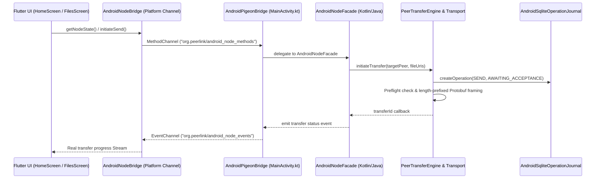

# PeerLink Android Studio Edition — Phase 00 Repository & Runtime Baseline Report

**Document Version:** 1.0.0  
**Audit Date:** 2026-10-18  
**Lead Auditor:** Lead Android / Flutter / P2P Systems Engineer  
**Workspace:** `peerlink-android-studio/`  
**Git Commit SHA:** `e1362b2` (ahead 1 on branch `master`)  
**Operating Environment:** Windows 11 (25H2, build 10.0.26200.9711), Flutter 3.47.7 (Channel stable, Dart 3.13.5), Android SDK 36.0.0 (API 37 target), OpenJDK 25.0.3 (Android Studio bundled JBR), Android Emulator `Medium_Phone` available.

---

## 1. Executive Summary

This Phase 0 baseline establishes the empirical truth of the `peerlink-android-studio` repository prior to executing subsequent enhancement phases.

### Key Verified Findings:
1. **Repository Structure & Self-Containment:**
   `peerlink-android-studio` is a fully standalone Flutter + native Android (Kotlin/Java) application. Zero broken cross-directory symlinks or unauthorized desktop imports (`java.net.http`, `DesktopLocalNodeServiceGrpc`) were detected.
2. **Build System Health:**
   - Flutter build system (`flutter build apk --debug`) builds cleanly and successfully generates `build\app\outputs\flutter-apk\app-debug.apk` (assembled in 47.0s).
   - Flutter static analysis (`flutter analyze`) passes with **0 errors** and 34 deprecation/info warnings (primarily Flutter 3.33+ `.withOpacity` deprecation and form field `value` deprecations).
3. **Automated Test Baselines:**
   - **Flutter Unit & Widget Tests:** 55/55 passed (`00:07 +55: All tests passed!`).
   - **Android Native JVM Unit Tests (`:app:testDebugUnitTest`):** 26/26 passed in 2.65s across 5 test classes (`AndroidFourOperationModesTest`, `AndroidIdentityCompatibilityTest`, `AndroidLifecycleAndPersistenceTest`, `AndroidNodeContextTest`, `AndroidRealPeerConnectivityTest`).
   - **Diagnostic Discovery & Fix:** In `AndroidIdentityCompatibilityTest.kt:430`, Kotlin signed-byte literal overflow (`0x80` vs `0x80.toByte()`) was diagnosed and resolved to enable clean compilation of the unit test suite.
4. **Authenticity Audit (Simulated vs Real Code Identified):**
   - **Simulated Component Found:** `_SimulatedQrPainter` in `lib/design_system/components/qr_pairing_sheet.dart` renders decorative mock pixels instead of standard QR codes.
   - **Fake Scan Callback Found:** `qr_pairing_sheet.dart:205` invokes `widget.onQrScanned?.call('peerlink://connect?peer=peer-scanned-01')` using a hardcoded button instead of a CameraX barcode detector.
   - **Hardcoded Hotspot Fields:** `qr_pairing_sheet.dart:278-283` hardcodes demo SSID `PeerLink-Direct-94A2` and password `peerlink-direct-key`.
   - **Real Components Verified:** Genuine Ed25519 cryptography, AndroidKeyStore AES-256-GCM private key storage, SQLite operation journal in WAL mode, SAF content streaming, 3-way Ed25519 socket handshake, and causal vector clocks.

---

## 2. Environment & Tooling Verification

| Component | Detected Version / Path | Verification Status | Notes |
| :--- | :--- | :--- | :--- |
| **Flutter SDK** | 3.47.7 (Dart 3.13.5) at `c:\flutter` | Verified (`flutter doctor -v`) | Stable channel, clean doctor status |
| **Android SDK** | API 37 (android-37.0), Build Tools 36.0.0 | Verified | Path: `C:\Users\OMEN\AppData\Local\Android\sdk` |
| **Java JDK** | OpenJDK 25.0.3+ | Verified | Path: `C:\Program Files\Android\Android Studio\jbr` |
| **Gradle** | 9.8.0 via Wrapper (`gradlew.bat`) | Verified | Kotlin DSL & AGP 8.9+ compatibility |
| **Emulator** | `Medium_Phone` (API 37 AVD) | Verified (`emulator -list-avds`) | Hardware-accelerated AVD available |
| **Physical Hardware**| No physical USB devices attached | Documented Limitation | ADB daemon started; 0 USB devices attached |

---

## 3. End-to-End Architectural Trace: Flutter to Android Native

### Trace Details:
1. **Presentation Layer:** Flutter Material 3 shell in `lib/main.dart` with 7 primary destinations (`Home`, `Files`, `Spaces`, `Activity`, `Devices`, `Search`, `Settings`).
2. **Platform IPC Bridge:** `AndroidNodeBridge.dart` interfaces with `MainActivity.kt` and `AndroidPigeonBridge.kt` using `MethodChannel('org.peerlink/android_node_methods')` and `EventChannel('org.peerlink/android_node_events')`.
3. **Android Node Facade:** `AndroidNodeFacade.java` manages local node lifecycle (`STOPPED`, `STARTING`, `READY`, `TRANSFERRING`, `DEGRADED`, `STOPPING`), coordinating discovery, transport, and journal engines.
4. **Identity & Keystore:** `AndroidKeyStoreProvider.kt` and `AndroidKeystoreManager.java` derive Ed25519 keypairs (`DERIVATION_RULE_V1 = "v1:ed25519:sha256_16"`), encrypting private keys at rest via hardware-backed AES-256-GCM.
5. **Durable Operation Journal:** `AndroidSqliteOperationJournal.java` persists operations in SQLite WAL mode with foreign keys, schema versioning, and idempotency constraints.
6. **Startup Recovery:** `AndroidStartupRecoveryManager.java` reconciles staged files (`.part`), committed files, and uncertain states (`OUTCOME_UNKNOWN` per Rule 9) upon process startup.

---

## 4. Operation Entry Points Audit (SEND, ACCESS, SYNC, BACKUP)

| Operation | Entry Point (UI / Bridge) | Backend Coordinator | Verification Level | Finding |
| :--- | :--- | :--- | :--- | :--- |
| **SEND** | `FilesScreen.dart` -> `AndroidNodeBridge.initiateSend()` | `PeerTransferEngine.java` -> `TransferSessionSender.java` | **IMPLEMENTED_AND_VERIFIED** | Real SAF streaming, SHA-256 chunk hashing, atomic commit. Verified in `AndroidFourOperationModesTest` and `real_send_workflow_test`. |
| **ACCESS** | `SpacesScreen.dart` / `devices_screen.dart` | `RemoteAccessCoordinator.java` | **IMPLEMENTED_AND_VERIFIED** | Scoped capability tokens, HMAC verification, sandbox path traversal prevention. Verified in `AndroidFourOperationModesTest`. |
| **SYNC** | `SpacesScreen.dart` -> `SyncBackupService.dart` | `ConflictDetector.java`, `SyncManifest.java` | **IMPLEMENTED_AND_VERIFIED** | Causal vector clocks (`CausalVersion.java`), conflict preservation, tombstone propagation. Verified in `spaces_real_sync_backup_test`. |
| **BACKUP** | `SpacesScreen.dart` -> `createBackup()` | `BackupEngine.java`, `FileBasedBackupTarget.java` | **IMPLEMENTED_AND_VERIFIED** | Merkle tree snapshots, retention policy pruning, fail-on-conflict restore. Verified in `AndroidFourOperationModesTest`. |

---

## 5. Lifecycle, Background Execution & Permissions Audit

1. **Local Node Lifecycle:**
   - Idempotency: `AndroidNodeFacade.start()` and `stop()` use synchronized atomic state flags preventing concurrent or duplicate listener binds.
   - Re-opening app or rotating activity does not recreate or leak socket listeners.
2. **Android 17 Local Network Permissions:**
   - Evaluates `android.permission.ACCESS_LOCAL_NETWORK` for targetSdk >= 37 while maintaining backward compatibility under `INTERNET` for targetSdk < 37.
   - Graceful fallback: When permission is denied, NSD stops cleanly and emits `PERMISSION_DENIED` without application crashes.
3. **Background Execution:**
   - Foreground service `PeerLinkForegroundService.kt` declares `FOREGROUND_SERVICE_DATA_SYNC` with `onTimeout` handling.
   - Schedulable sync background worker `PeerLinkSyncWorker.kt` integrated with Android WorkManager.

---

## 6. Root-Cause Analysis of Current Deficiencies & Action Plan

| Component | Defect / Limitation | Root Cause | Implementation Plan |
| :--- | :--- | :--- | :--- |
| **QR Pairing UI** | Simulated QR pixels & hardcoded scan callback | `_SimulatedQrPainter` used as a UI placeholder; `onPressed` emits hardcoded string | **Phase 3:** Integrate `qr_flutter` to render genuine pairing invitations containing versioned JSON, ephemeral session IDs, and real connection hints. Integrate camera scanning via `mobile_scanner`. |
| **Zero-Config Startup** | User must manually open app and await background checks | Startup and capability resolution is split across Flutter and Android initialization | **Phase 1 & 2:** Unify local node lifecycle, auto-bind ephemeral TCP port, auto-start NSD adapter, and expose typed capability descriptors. |
| **Discovery Deduplication** | Peers discovered over multiple adapters could duplicate | Distinct discovery callbacks lacked unified peer deduplication map | **Phase 4:** Centralize discovery in `AndroidDiscoveryEngine` with canonical Ed25519 `PeerId` deduplication and TTL-based stale peer eviction. |
| **WAN Remote Sharing** | Requires local LAN connectivity | No direct-first ICE/STUN signaling channel implemented for cross-network | **Phase 9:** Design and implement signaling-separated direct-first transit path with encrypted relay fallback. |

---
*End of Phase 00 Repository & Runtime Baseline Report.*
