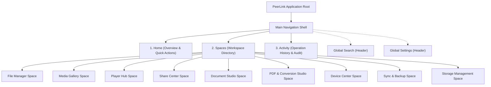

# PeerLink — Navigation Flow Architecture Specification

**Document Version:** 1.0.0  
**Phase:** 13.0 Complete Product-Wide UX Redesign  

---

## 1. Global Navigation Topology

PeerLink replaces nested, competing bottom navigation bars with a clean **3-Destination Global Shell**:

---

## 2. Global Destinations

### 1. Home
- **Purpose:** Central operational overview answering 4 core user questions:
  1. *Are my devices connected?* (Node daemon status & trusted peer chip)
  2. *Are background operations running?* (Active transfer telemetry card)
  3. *What should I continue using?* (Recent files & recently used Spaces shortcuts)
  4. *How do I start a common action?* (Quick Actions: Send, Receive, Browse Files, Open Gallery, Scan Doc)

### 2. Spaces (Workspace Directory)
- **Purpose:** The dedicated workspace launcher providing direct access to the 9 professional workspaces.
- **Presentation:** A clean, categorized grid of the 9 dedicated productivity spaces with badge indicators showing active sessions (e.g. "2 active transfers", "1 space syncing", "Now playing").
- **Navigation:** Tapping any Space opens that dedicated workspace in full page mode with standard back-navigation to the directory.

### 3. Activity (Operation History)
- **Purpose:** Unified operation history across all 5 product operations (SEND, ACCESS, SYNC, BACKUP, CONNECT).
- **Features:** Categorized filter chips (All, Transfers, Sync, Backup, Security, Quarantined) with real-time journal event details and retry/recovery paths.

---

## 3. Responsive Navigation Adapters

| Viewport Class | Breakpoint | Navigation Adapter | Placement |
| :--- | :--- | :--- | :--- |
| **Compact (Phones)** | `< 600dp` | `NavigationBar` | Bottom of screen (3 destinations: Home, Spaces, Activity). |
| **Medium (Foldables, Small Tablets)** | `600dp - 840dp` | `NavigationRail` | Left edge, vertical rail (3 destinations + Search/Settings at bottom). |
| **Expanded (Desktops, Large Tablets)** | `> 840dp` | Persistent Sidebar Drawer | Left edge, permanent 220dp sidebar with direct links to Spaces. |

---

## 4. State Preservation Across Workspaces

When navigating between Spaces or switching global tabs:
- **Scroll positions** are preserved via `PageStorageKey`.
- **Active operations** (streaming P2P transfers, video playback, document compilation, file hashing) run in singleton background services and remain completely un-interrupted.
- **Search queries and selection trays** are persisted in `FileStagingService` and `SearchStateService`.
