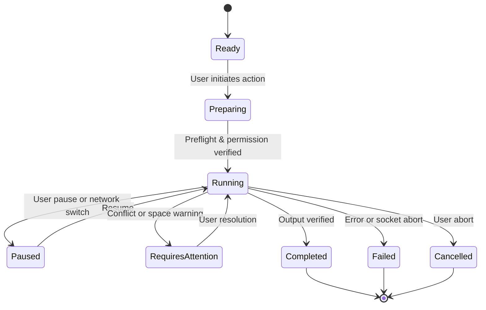

# PeerLink — Operation State and Feedback Specification

**Document Version:** 1.0.0  
**Phase:** 13.0 Complete Product-Wide UX Redesign  
**Core Rule:** Never merge distinct operations (SEND, ACCESS, SYNC, BACKUP, CONNECT) into a generic 'Sync' or 'Cloud' state.  

---

## 1. Unified Operation Lifecycle

Every long-running operation in PeerLink progresses through an explicit, deterministic lifecycle:

### 1.1 Operation States

1. **`Ready`:** Standby state with zero active resource allocation.
2. **`Preparing`:** Calculating byte counts, verifying available disk space (preflight), and checking permissions.
3. **`Running`:** Active data transfer, file processing, or Merkle hashing. Displays real-time byte counters, percentage, and smoothed transfer speed.
4. **`Paused`:** Temporarily suspended. Preserves in-memory state and SQLite WAL chunk records without deleting `.part` staging files.
5. **`RequiresAttention`:** Halted pending user decision (e.g. causal conflict detection, mass-change safety threshold reached, untrusted peer incoming transfer offer).
6. **`Completed`:** Operation successfully finalized and cryptographically verified (SHA-256 match).
7. **`Failed`:** Deterministic failure explanation with actionable recovery path (e.g. "Destination disk full", "Peer rejected connection", "Wi-Fi disconnected").
8. **`Cancelled`:** Aborted by user. Informs the user whether partial files were safely removed or preserved in quarantine.
